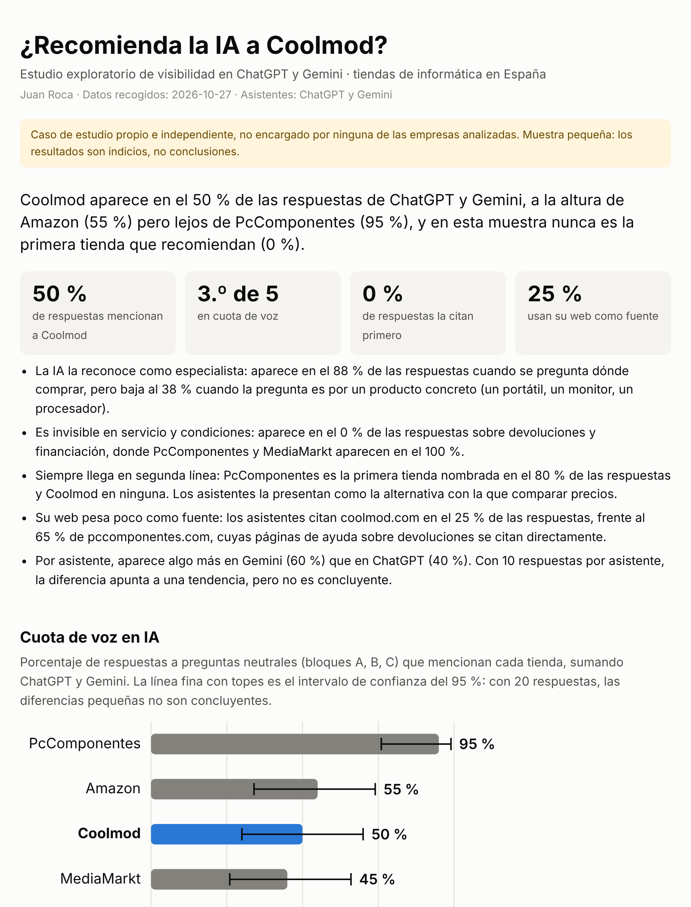
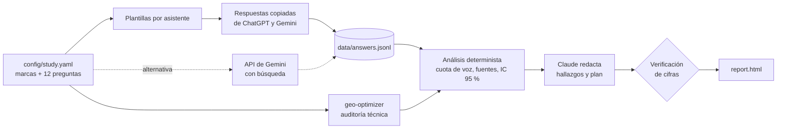

# GEO Visibility Study

**¿Recomienda la IA a tu marca? Mide cuántas veces ChatGPT y Gemini mencionan una marca frente a su competencia cuando un cliente pregunta dónde comprar, qué webs usan para responder y qué hay que cambiar para aparecer más.**


Caso aplicado con datos reales: **Coolmod**, tienda española especializada en informática, frente al líder PcComponentes, Amazon, MediaMarkt y su competidor directo Neobyte, con respuestas reales de ChatGPT y Gemini recogidas el 27 de octubre de 2026. Es un caso de estudio propio e independiente, no encargado por ninguna de estas empresas.

**[Ver el informe completo](https://jm-roca.github.io/geo-visibility-study/)** · datos recogidos el 27 de octubre de 2026

[](https://jm-roca.github.io/geo-visibility-study/)

**Resultado en una frase:** Coolmod aparece en el 50 % de las respuestas de ChatGPT y Gemini, pero nunca como primera recomendación; es fuerte cuando se pregunta dónde comprar (88 %) e invisible en devoluciones y financiación (0 %).

---

## El problema

Cada vez más compradores preguntan a un asistente de IA en lugar de a Google: *«¿dónde compro una tarjeta gráfica en España?»*. El asistente no devuelve diez enlaces: nombra dos o tres tiendas. Estar en esa respuesta es la nueva «primera página de Google», y casi ninguna empresa lo mide.

## Qué mide

| Indicador | Qué responde |
|---|---|
| **Cuota de voz en IA** | ¿En qué % de las respuestas aparece cada tienda? Con intervalo de confianza del 95 %. |
| **Por asistente** | ¿Está igual de bien en ChatGPT que en Gemini? |
| **Por tipo de pregunta** | ¿Dónde es fuerte y dónde débil? Elegir tienda, producto concreto, servicio y condiciones. |
| **Primera recomendación** | ¿En qué % de respuestas es la primera tienda que se nombra? |
| **Fuentes** | ¿Qué webs leen los asistentes para responder? ¿La de la marca o foros y medios? |
| **Reputación** | Cuando se pregunta directamente por la marca, ¿qué dicen y en qué se basan? |
| **Auditoría técnica** | ¿Está la web preparada para que la IA la rastree, la entienda y la cite? |

El resultado es un informe HTML (se abre en cualquier navegador y se exporta a PDF) con hallazgos y un **plan de acción priorizado**.

## Cómo funciona



1. **Recogida.** Dos vías con el mismo resultado:
    - **Manual (gratis, por defecto):** las preguntas se hacen en las apps de ChatGPT y Gemini y las respuestas se pegan en una plantilla. Mide exactamente lo que ve un usuario real.
    - **API de Gemini con búsqueda en Google:** automática, con repeticiones. Requiere cuota de API.
2. **Auditoría técnica.** Se reutiliza [geo-optimizer](https://github.com/Auriti-Labs/geo-optimizer-skill) (MIT), una herramienta abierta y probada, en lugar de reinventarla.
3. **Análisis.** Código determinista, sin IA: mismas respuestas, mismas cifras. Las respuestas brutas se guardan, así que cualquier cifra se puede rastrear hasta su origen.
4. **Redacción.** Claude convierte los indicadores en hallazgos y acciones, con una estructura fija. Por API, o gratis pegando un prompt preparado en Claude.ai.
5. **Verificación.** El código comprueba que **cada porcentaje que escribe la IA existe en el análisis**. Si se inventa una cifra, el informe lo marca.

## Cómo ejecutarlo

```bash
git clone https://github.com/jm-roca/geo-visibility-study.git
cd geo-visibility-study
pip install -r requirements.txt

# Modo de prueba: sin claves, con datos de ejemplo inventados (solo para probar la herramienta)
python -m geo_study report --demo          # → output/demo/report.html
```

**Estudio real, con opción a recogida manual:**

```bash
python -m geo_study template    # crea data/manual/chatgpt.md y data/manual/gemini.md
#   → haz cada pregunta en la app y pega la respuesta en su hueco
python -m geo_study import      # comprueba lo que falta y prepara los datos
python -m geo_study audit       # auditoría técnica de las 5 webs
python -m geo_study report      # → output/report.html
```

**Plan de acción sin clave de API:** `report` genera `output/prompt_para_claude.md`. Se pega en un chat de Claude.ai y el JSON que devuelve se guarda como `data/narrative.json`. Al volver a ejecutar `report`, el plan de acción aparece en el informe y sus cifras se verifican igual. Con `ANTHROPIC_API_KEY` en `.env`, este paso es automático.

**Recogida por API (alternativa):** `python -m geo_study collect` con `GEMINI_API_KEY` en `.env`. Hace pausas entre llamadas, gestiona los límites de uso (error 429) y, si se corta, continúa donde se quedó. `python -m geo_study models` muestra qué modelos puede usar tu clave.

Tests: `pytest -v`.

## Estudiar otra empresa u otro sector

Todo lo específico vive en [`config/study.yaml`](config/study.yaml): marcas, variantes de nombre (`Coolmod`, `CoolMod`, `coolmod.com`...), preguntas agrupadas por intención y asistentes a comparar. Para analizar, por ejemplo, partners de software en Barcelona, o añadir Perplexity, se cambia ese archivo. No hay que tocar código.

## Decisiones de diseño

- **Recogida manual como vía principal.** Es gratis, permite comparar varios asistentes y mide lo que ve el público en la app, que puede diferir de la API. El análisis no distingue la vía: los dos caminos producen el mismo `answers.jsonl`.
- **IA para redactar, código para medir.** Las cifras nunca salen de la IA. Claude recibe los indicadores ya calculados y solo los interpreta. Después, el código verifica cada porcentaje.
- **Honestidad estadística.** Con 20 respuestas, una diferencia de 10 puntos puede ser ruido. Por eso cada cuota de voz lleva su intervalo de confianza (método de Wilson, adecuado para muestras pequeñas).
- **No reinventar.** La auditoría técnica usa geo-optimizer con la versión fijada (`4.19.8`), para que el estudio se pueda repetir dentro de un mes con el mismo motor.
- **Modo de prueba separado del estudio real.** Para probar la herramienta sin claves, y para los tests automáticos, hay un conjunto de datos de ejemplo con tiendas inventadas. El estudio de Coolmod usa respuestas reales; las dos cosas nunca se mezclan.
- **Sin secretos ni datos brutos en el repositorio:** las claves van en `.env` y las respuestas copiadas en `data/`, ambos excluidos en `.gitignore`. Se publica el código y el informe final (`docs/index.html`).

## Limitaciones

- **Muestra pequeña:** 12 preguntas, una respuesta por asistente. Son indicios, no conclusiones.
- **Foto de un momento:** las respuestas de la IA cambian con el tiempo, la cuenta y la ubicación.
- **Detección por nombre:** una tienda cuenta como mencionada si su nombre o dominio aparece en el texto.
- **Fuentes:** solo se cuentan cuando el asistente las muestra.
- **Auditoría técnica solo de la página de inicio.** Algunas webs bloquean a los rastreadores automáticos; en ese caso se indica en el informe.

## Estructura

```
config/study.yaml        marcas, alias, preguntas y asistentes del estudio
geo_study/
  manual.py              plantillas y lectura de respuestas pegadas desde las apps
  gemini.py              consulta a Gemini por API con búsqueda en Google
  collect.py             recogida por API, reanudable
  audit.py               auditoría técnica con geo-optimizer
  analyze.py             cuota de voz, por asistente, fuentes, intervalos de confianza
  narrative.py           redacción con Claude (API o Claude.ai) + verificación de cifras
  report.py              informe HTML (gráficos SVG propios) y Markdown
  cli.py                 comandos template / import / collect / audit / report / models
examples/demo/           datos de ejemplo inventados para el modo de prueba (no forman parte del estudio)
scripts/make_demo_data.py  genera los datos del modo de prueba
tests/                   tests automáticos (GitHub Actions en cada push)
```

## Próximos pasos

- Repetir la medición cada mes y mostrar la evolución.
- Añadir Perplexity como tercer asistente (una línea en la configuración).
- Usar las skills de corrección de [geoskills](https://github.com/Cognitic-Labs/geoskills) para pasar del diagnóstico a los cambios en la web.

---

Autor: **Juan Roca** · [LinkedIn](https://www.linkedin.com/in/juanma-roca)
